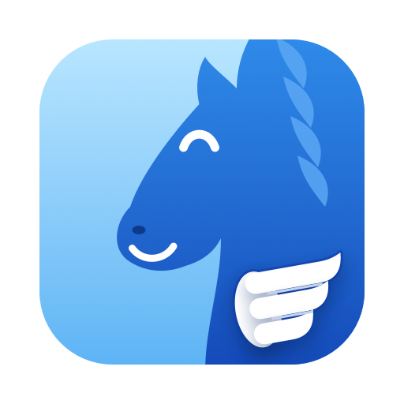

<p align="center">
  
</p>

<h1 align="center">PegasusExplorer</h1>

<p align="center">
  <b>El Explorador de archivos de Windows, en tu Mac.</b><br>
  Para macOS 13 Ventura o posterior · Intel y Apple silicon · Gratis y de código abierto
</p>

<p align="center">
  <a href="https://github.com/Jonywaper/PegasusExplorer/releases/latest"><b>Descargar</b></a>
</p>

Windows-style file explorer for macOS 13 Ventura and later (Sonoma, Sequoia, Tahoe), on Intel and Apple silicon Macs. Tabs, folder tree, Windows ribbon, Google Drive and network drives. Free and open source (AGPL-3.0). Inspired by [OpenXplorer](https://github.com/AKolenda/openxplorer).

Explorador de archivos estilo Windows para macOS, nativo en Swift y sin dependencias. Pensado sobre todo para quienes vienen de Windows y para Macs que se quedaron en macOS 13 Ventura, aunque funciona igual en versiones más nuevas.

## Compatibilidad

| | |
|---|---|
| **macOS** | 13 Ventura, 14 Sonoma, 15 Sequoia y 26 Tahoe |
| **Procesador** | Intel y Apple silicon (M1, M2, M3, M4…) |
| **Probado en** | macOS 13.7 Ventura en una Mac Intel |

No funciona en macOS 12 Monterey ni anteriores: usa funciones de macOS 13.

## Funciones (versión 0.9 beta)

- **Cinta de opciones** como la de Windows 10, con las pestañas Archivo, Inicio, Compartir y Vista:
  - **Inicio:** anclar al Acceso rápido; copiar, cortar y pegar; copiar ruta de acceso; pegar acceso directo; mover a, copiar a, eliminar, cambiar nombre; nueva carpeta, nuevo elemento; propiedades, abrir con; seleccionar todo, ninguno, invertir.
  - **Compartir:** compartir, correo electrónico, comprimir en ZIP, AirDrop y etiquetas de color.
  - **Vista:** panel de navegación y de vista previa; iconos grandes, iconos medianos, mosaicos y detalles; ordenar; extensiones de archivo; elementos ocultos.
- **Menú de clic derecho** como el de Windows:
  - Abrir, abrir con, abrir en pestaña o ventana nueva y anclar al Acceso rápido.
  - Compartir, enviar a, cortar, copiar, crear acceso directo, eliminar, cambiar nombre y propiedades.
  - Extraer todo (en archivos ZIP).
- **Este equipo**, como en Windows: carpetas, discos con barra de espacio libre y ubicaciones de red. «Disco local» abre la raíz real del disco.
- **Pestañas** y **varias ventanas**.
- **Barra de direcciones** al estilo «Este equipo › Disco local › …». Haz clic en el espacio vacío (o `Ctrl+L`) para escribir una ruta, `\\servidor\carpeta` o `smb://servidor/carpeta`.
- **Botones de navegación:** Atrás (carpeta anterior), Adelante, ubicaciones recientes y Subir (carpeta superior).
- **Carpetas amarillas** como en Windows, y **miniaturas** de fotos, PDF, videos y documentos en las vistas de iconos.
- **Aviso de actualizaciones:** al abrirla revisa una vez al día si hay una versión nueva en GitHub (se puede desactivar en el menú Archivo).
- **Google Drive, OneDrive, Dropbox e iCloud Drive** en Este equipo y en el panel de navegación. Si tienes varias cuentas, cada una aparece con su correo, como en Windows. Google Drive muestra además su espacio disponible.
- **Unidades de red:** SMB, AFP, NFS, FTP y WebDAV. macOS pide el usuario y la contraseña y los guarda en el llavero.
- **Funciones de Finder que Windows no tiene:**
  - Vista rápida (barra espaciadora) y panel de vista previa.
  - Etiquetas de color.
  - Duplicar (`Cmd+D`) y Nueva carpeta con la selección.
  - Mostrar contenido del paquete.
  - AirDrop y Compartir.
  - Abrir en Terminal y Mostrar en Finder.
- **Explorador predeterminado** (menú Archivo): hace que las carpetas que abren otras apps se abran en PegasusExplorer. macOS no permite reemplazar el Finder por completo (el Escritorio y «Mostrar en Finder» siguen usándolo).
- **Copiar y pegar compatible con Finder.** Las copias se llaman «nombre - copia», como en Windows.

## Instalar

1. Descarga `PegasusExplorer-<versión>.dmg` desde [Releases](https://github.com/Jonywaper/PegasusExplorer/releases/latest).
2. Ábrelo y arrastra **PegasusExplorer** a **Aplicaciones**.
3. Ábrelo desde Aplicaciones.

Funciona en Macs Intel y Apple silicon con macOS 13 Ventura o posterior.

**La primera vez macOS lo va a bloquear.** La app es gratuita y no está notarizada por Apple, porque eso requiere una cuenta de desarrollador de pago. Para abrirla, ve a **Configuración del Sistema → Privacidad y seguridad**, baja hasta el aviso de PegasusExplorer y haz clic en **Abrir de todos modos**. Solo hay que hacerlo una vez.

Si prefieres no hacerlo, compílala tú mismo (instrucciones abajo). Una app compilada en tu propia Mac no se bloquea.

## Atajos de teclado

Funcionan con `Ctrl` (como en Windows) y con `Cmd` (como en Mac). `Alt` es la tecla `Option`.

| Atajo | Acción |
|---|---|
| `Ctrl+C` / `Ctrl+X` / `Ctrl+V` | Copiar, cortar, pegar |
| `Ctrl+A` | Seleccionar todo |
| `Espacio` | Vista rápida |
| `Alt+Enter` / `Cmd+I` | Propiedades |
| `Alt+P` | Panel de vista previa |
| `Mayús+Supr` | Eliminar permanentemente |
| `Ctrl+N` | Ventana nueva |
| `F2` | Cambiar nombre |
| `Supr` (fn+Delete) o `Cmd+Delete` | Enviar a la Papelera |
| `Enter` | Abrir |
| `Delete` (retroceso) / `Alt+Izquierda` | Atrás |
| `Alt+Derecha` | Adelante |
| `Alt+Arriba` | Carpeta superior |
| `F5` / `Ctrl+R` | Actualizar |
| `Ctrl+L` / `Alt+D` / `F4` | Escribir en la barra de direcciones |
| `Ctrl+F` / `F3` | Buscar en la carpeta |
| `Ctrl+Shift+N` | Nueva carpeta |
| `Ctrl+Shift+C` | Copiar ruta de acceso |
| `Ctrl+H` | Mostrar u ocultar elementos ocultos |
| `Ctrl+K` | Conectar a unidad de red |
| `Ctrl+T` / `Ctrl+W` | Nueva pestaña, cerrar pestaña |
| `Ctrl+Tab` / `Ctrl+Shift+Tab` | Pestaña siguiente, anterior |
| `Ctrl+1` … `Ctrl+9` | Ir a la pestaña |

## Compilar

Solo necesitas las Command Line Tools de Apple (`xcode-select --install`). No hace falta Xcode ni Homebrew.

```bash
./build.sh
open build/PegasusExplorer.app
```

`./build.sh --universal` genera una app para Intel y Apple silicon, y `Tools/make-dmg.sh` crea el instalador DMG.

El ícono se dibuja con código en `Tools/MakeIcon.swift`.

Para dejarla en Aplicaciones:

```bash
cp -R build/PegasusExplorer.app /Applications/
```

La primera vez que abras Escritorio, Documentos, Descargas o un disco externo, macOS te pedirá permiso. Hasta que lo permitas, esas carpetas se ven vacías.

## Pendiente

Doble panel, arrastrar y soltar, deshacer y cambiar nombre directamente en la lista.

## Licencia

[AGPL-3.0](LICENSE). Proyecto independiente, inspirado en el diseño y las funciones de [OpenXplorer](https://github.com/AKolenda/openxplorer) (AGPL-3.0).

No está afiliado a Microsoft ni a Apple. Windows y macOS son marcas de sus respectivos dueños.
